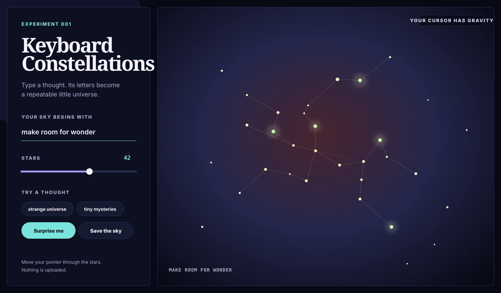

# Keyboard Constellations

Type a thought and watch its letters become a repeatable little universe.



## Play with it

Open [`index.html`](index.html) in a modern browser. No build step, packages,
account, or network connection are required.

- Type in the field and the sky changes immediately.
- Change the star count to make the thought quieter or denser.
- Move the pointer through the canvas; nearby stars give it a little space.
- Choose **Save the sky** to export the current canvas as a PNG.

Run the deterministic logic tests with:

```bash
node --test test_constellation.js
```

## The interesting rule

The normalized phrase is hashed into a seed. A seeded random generator combines
each character code with the golden angle, producing an even but distinctive
spiral of stars. Every star connects to its nearest recent neighbor, so the
picture reads as a constellation rather than a cloud of unrelated dots.

The phrase, canvas size, and chosen density fully determine the model. Re-entering
the same inputs reconstructs the same coordinates, colors, connections, and
twinkle phases. Pointer gravity changes only how the model is drawn; it never
mutates the underlying sky.

## Small pieces of care

- The drawing responds to narrow and wide screens and caps pixel density to keep
  large displays from doing unnecessary work.
- Motion stops when the operating system requests reduced motion; pointer response
  still works because it is directly controlled by the visitor.
- Controls use native labels, keyboard focus, live status text, and written hints.
- The project has no telemetry and never uploads the phrase or exported image.
- Logic is separated from browser drawing so determinism and geometry can be
  tested without taking screenshots.

## Limitations

This is a visual toy, not astronomy or cryptography. Canvas content is summarized
for assistive technology rather than exposed star by star, and font rendering in
exported images varies by operating system. The layout is deterministic for a
given viewport—not identical across differently sized screens.
