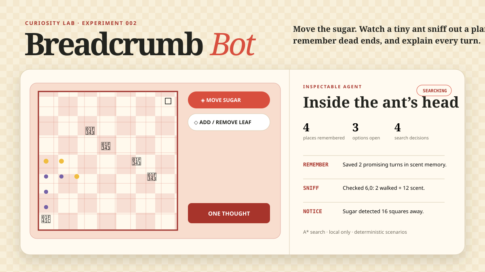

# Breadcrumb Bot

Move the sugar and watch a tiny ant sniff out a plan, remember dead ends, and
explain every turn.



## Play with it

Open [`index.html`](index.html) in a modern browser. It needs no installation,
account, model download, network connection, or API key.

- Choose **Move sugar**, then tap any free square to give the ant a new goal.
- Choose **Add / remove leaf** to reshape the problem.
- Press **One thought** to inspect the search one decision at a time, or **Let it
  think** to watch the complete search and walk.
- Try the three picnic layouts. The dots on the blanket reveal remembered places,
  open possibilities, and the chosen trail.

Run the deterministic agent scenarios with:

```bash
node --test test_agent.js
```

## The interesting rule

This is a small search agent, not a chatbot wearing an ant costume. It uses A*
search to choose which square to inspect next. Each option gets a score:

```text
steps already walked + Manhattan distance to the sugar
```

The lowest score wins; row and column provide stable tie-breaking. The agent
stores the cheapest known route to every discovered square, avoids leaves, and
reconstructs the winning trail from parent memories. **Sniff**, **remember**,
**plan**, and **walk** events expose the loop instead of hiding it behind an
animated result.

The tests treat the picnic layouts as compact evaluations: shortest-route
behavior, deterministic decisions, obstacle avoidance, unreachable goals,
stable terminal states, and invalid worlds all have explicit scenarios.

## Small pieces of care

- Editing the blanket clears stale memory so the explanation always matches the
  visible world.
- Every square is a keyboard-focusable button with a spoken row, column, and role.
- The layout collapses cleanly on small screens, and reduced-motion preferences
  disable trace animation.
- Search logic is isolated from the interface and uses no browser APIs, making
  its state transitions straightforward to test.
- Everything runs locally. Nothing is uploaded, tracked, or generated remotely.

## Limitations

The ant sees the entire blanket from the start; it does not learn an unknown map.
Its scent estimate only works for four-directional, equal-cost movement, and its
memory disappears whenever the picnic changes or the page closes. A* is a
classical planning algorithm—not a language model or evidence that the ant
understands picnics.
