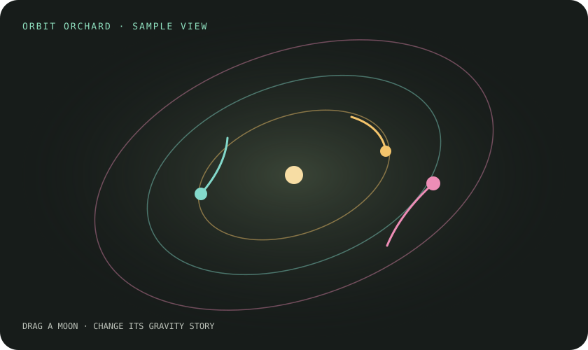

# Orbit Orchard

Drag a moon or widen its orbit, then watch its little path grow around a glowing star.

## Play with it

Open `index.html` in a modern browser. Drag one of the moons, or use the Moon and Orbit radius controls to reshape its path with a keyboard. Pause to inspect the trails; Start over restores the original three circular paths. Everything runs locally without setup, accounts, network requests, or a model.

The same deterministic physics can be checked with `node --test test_orbits.js`.

## The interesting rule

Each moon feels the pull of a fixed central mass. A velocity-Verlet step updates position and speed in two half-kicks, which keeps energy drift small at the chosen step size. Dragging replants a moon and gives it the tangential speed for a circular orbit at its new radius; the trails make later deviations visible.

## Limits

This is a two-dimensional teaching sketch, not an astronomy simulator. The star is fixed, moons do not pull on one another, and the softened gravity near the center is chosen for stable play rather than physical realism. Paths are clipped by the view, and the model does not include collisions or relativistic effects.
